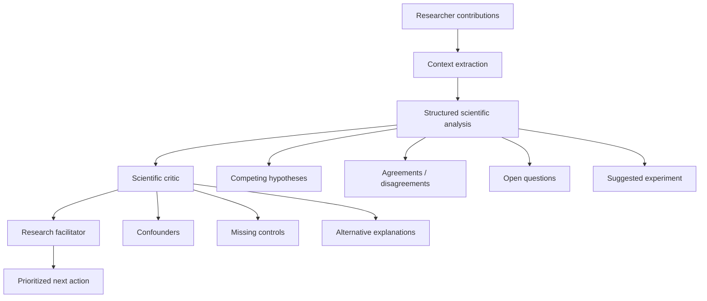

# BridgeBoard

**AI-assisted research collaboration workspace built during an Amazon/AWS hackathon.**

BridgeBoard helps research teams turn multilingual discussion, meeting transcripts, documents, and project updates into structured scientific reasoning and concrete next actions. The original hackathon deployment used a serverless AWS architecture with Amazon Bedrock/AgentCore, Lambda, API Gateway, DynamoDB, Cognito, S3, Comprehend, Textract, Translate, Transcribe, Polly, CloudFront, and Bedrock Guardrails.

The hackathon AWS account is no longer available, so this public portfolio version intentionally contains **no live AWS resource identifiers or credentials**. The React application still runs locally in **portfolio demo mode**, where the core research-analysis flow uses deterministic synthetic outputs while preserving the original cloud implementation under `backend/`, `infrastructure/`, and `BridgeBoardAgents/`.

## Why BridgeBoard

Research collaboration breaks down when ideas are spread across meetings, chat messages, documents, languages, and different levels of seniority. BridgeBoard was designed around a narrower goal than a generic chatbot: preserve scientific disagreement, surface evidence gaps, and recommend the next useful research action without manufacturing consensus.

The core reasoning pipeline separates four concerns:

1. **Context extraction** — language, entities, and key phrases.
2. **Structured research analysis** — hypotheses, evidence, agreements, disagreements, and open questions.
3. **Scientific critique** — confounders, missing controls, unsupported claims, and alternative explanations.
4. **Facilitation** — one prioritized next action for the research team.

## Highlights

- Structured AI analysis of multi-researcher discussions
- Scientific-critic pass focused on methodological weaknesses rather than people
- Research facilitator that preserves minority viewpoints and unresolved hypotheses
- Multi-model Bedrock integration through the Converse API
- Amazon Bedrock AgentCore facilitator implementation using Strands
- Multilingual text workflow with Amazon Translate
- Voice transcription with Amazon Transcribe and speaker diarization
- Text-to-speech with Amazon Polly
- PDF/image text extraction with Amazon Textract
- NLP context extraction and PII detection with Amazon Comprehend
- Real scholarly-paper discovery through OpenAlex for literature-study commands
- Private research rooms and meeting records
- Lab-memory/onboarding workspace
- Experiment provenance tracking
- Manuscript lifecycle tracking
- Advising/mentorship dashboard
- Cognito authentication and API Gateway JWT authorization
- S3 pre-signed uploads with private-bucket access controls
- DynamoDB single-table persistence
- Infrastructure as Code with AWS CloudFormation
- Multi-layer content safety using Bedrock Guardrails, Comprehend PII checks, and application validation

## Architecture

```text
React 19 + Vite
      |
      | HTTPS + Cognito JWT
      v
Amazon API Gateway
      |
      v
AWS Lambda (Python)
      |
      +-- DynamoDB       collaboration state
      +-- S3             private file storage
      +-- Bedrock        research reasoning
      +-- AgentCore      facilitator agent runtime
      +-- Comprehend     NLP + PII checks
      +-- Textract       document OCR
      +-- Translate      multilingual text
      +-- Transcribe     speech-to-text + diarization
      +-- Polly          text-to-speech
      |
      v
CloudFront + private S3 frontend
```

For the detailed design, see [`docs/architecture.md`](docs/architecture.md), [`docs/aws-services.md`](docs/aws-services.md), and [`docs/research-reasoning.md`](docs/research-reasoning.md).

## Research Reasoning Pipeline



The live hackathon version mapped these stages to Amazon Comprehend, Amazon Bedrock, and an AgentCore/Strands facilitator. The public portfolio demo uses precomputed synthetic reasoning so reviewers can inspect the UI without an AWS account.

## Run Locally

Prerequisite: Node.js 20+.

```bash
npm install
npm run dev
```

Open the Vite URL shown in the terminal, normally `http://localhost:5173`.

No `.env` file is required. Without AWS configuration, BridgeBoard automatically runs in **portfolio demo mode**. The Research Hub opens in the three-researcher demo and supports the analysis → critic → facilitator flow with clearly labeled synthetic outputs.

### Optional AWS configuration

If you deploy the included AWS stack in your own account, copy `.env.example` to `.env.local` and provide the non-secret frontend configuration created by the stack:

```bash
cp .env.example .env.local
```

```text
VITE_API_URL=<your-api-gateway-url>
VITE_COGNITO_USER_POOL_ID=<your-user-pool-id>
VITE_COGNITO_CLIENT_ID=<your-app-client-id>
VITE_COGNITO_DOMAIN=<your-cognito-domain>
```

Do not commit `.env.local`, AWS credentials, AgentCore deployment state, or account-specific resource identifiers.

## Important Demo/Cloud Distinction

| Capability | Portfolio demo | Original AWS implementation |
|---|---:|---:|
| Browse main research/lab UI | Yes | Yes |
| Three-researcher analysis flow | Deterministic synthetic output | Amazon Bedrock |
| Scientific critic | Deterministic synthetic output | Amazon Bedrock |
| Research facilitator | Deterministic synthetic output | Bedrock AgentCore + Strands |
| NLP context extraction | Deterministic synthetic output | Amazon Comprehend |
| Persistent collaboration state | UI/demo data | DynamoDB |
| Authentication | Not required | Amazon Cognito |
| File OCR | No | Amazon Textract |
| Translation | No live service | Amazon Translate |
| Voice transcription | No live service | Amazon Transcribe |
| Speech synthesis | No live service | Amazon Polly |
| Cloud deployment | Not required | CloudFormation + S3 + CloudFront |

This distinction is intentional: the repository demonstrates the original cloud architecture without pretending that expired hackathon resources are still online.

## Agent Commands

The research discussion interface was designed around commands such as:

```text
/ask
/summarize
/extract
/analyze
/search
/translate
/todo
/litstudy
/remember
```

The AWS backend routes commands to the appropriate service. For example, `/litstudy` queries OpenAlex for real scholarly metadata and uses Bedrock to synthesize a cited literature study; `/extract` uses Textract for documents; `/analyze` uses Comprehend; and `/todo` uses Bedrock to convert a discussion into structured action items.

See [`docs/agent-commands.md`](docs/agent-commands.md).

## Safety and Research Integrity

BridgeBoard treats researcher messages and uploaded document text as untrusted input. The cloud implementation includes:

- Amazon Bedrock Guardrails for managed content filtering and prompt-attack protection
- Amazon Comprehend PII detection with blocking for high-severity identifiers
- explicit prompt instructions not to follow instructions embedded inside research content
- backend model allowlists
- length limits and input sanitization
- file-approval confirmation before document content is sent to a model
- Cognito JWT authorization
- private S3 storage with pre-signed access

The scientific prompts also explicitly prohibit invented evidence/citations, forced consensus, and person-directed judgments.

See [`docs/guardrails.md`](docs/guardrails.md).

## Repository Structure

```text
BridgeBoard/
├── src/                       React frontend
│   ├── features/              research hub, rooms, memory, provenance, etc.
│   └── lib/                   API client + portfolio demo reasoning
├── backend/                   Python Lambda implementation
│   ├── handler.py
│   ├── ingestion/             Translate / Polly / Transcribe helpers
│   └── research/              OpenAlex research integration
├── BridgeBoardAgents/         AgentCore + Strands facilitator agent
├── infrastructure/            CloudFormation template
├── scripts/                   deployment and demo-data utilities
├── docs/                      architecture and design documentation
└── .env.example               safe configuration template
```

## Historical AWS Deployment

The original hackathon build was deployed to AWS and exercised the cloud path through API Gateway, Lambda, DynamoDB, Bedrock, Cognito, S3, and the supporting AI services documented above. Those temporary hackathon resources are no longer treated as active dependencies of this portfolio repository.

Account IDs, temporary endpoints, Cognito identifiers, and generated AgentCore deployment state have been removed from the public copy.

## Project Status

This repository is a **portfolio restoration of a hackathon prototype**, not a production research-management system. The design is intended to demonstrate full-stack cloud/AI architecture, agent orchestration, safety controls, and human-centered scientific collaboration workflows.

Production use would require updated deployment testing, cost controls, stronger tenancy/isolation, retention policies, accessibility review, observability, and a formal security/privacy assessment.

## Attribution

BridgeBoard was developed as a team hackathon project. When presenting or reusing this repository, preserve teammate attribution and describe individual contributions accurately.
